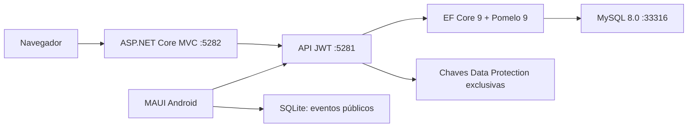
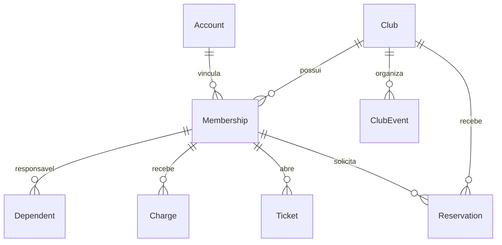

# Arquitetura e persistência

## Projetos

`Core` contém contratos públicos, enums e regras sem dependência da UI. `Api` contém endpoints ASP.NET Core, autenticação JWT, autorização contextual (`Access`), EF Core/Pomelo e migrations. `Web` é ASP.NET Core MVC, comunica-se por HttpClient com a API e conserva o token somente na sessão do servidor. `Mobile` é MAUI Android com HttpClient, SecureStorage e SQLite de conteúdo público. `Tests` contém regras xUnit e cenário HTTP real contra API/MySQL.

Mantivemos uma API compacta com endpoints mínimos e DTOs separados das entidades para facilitar o estudo. Não é uma implementação de arquitetura hexagonal ou repositórios genéricos. Não há dependência do projeto de Panificação.

## Modelo

| Entidade | Campos e restrições relevantes |
|---|---|
| Club | Identidade própria, identificação/endereço/contato, MonthlyFee decimal(12,2) |
| Account | Nome, e-mail normalizado único, PasswordHash Identity, flag SuperAdmin |
| Membership | ClubId + AccountId únicos; role/tipo/status por clube; hash de CPF único por clube; dados de perfil; ciência de privacidade |
| Dependent | FK Membership, nome e nascimento criptografados, parentesco |
| ClubEvent | FK Club, título, início/fim, público, cancelado |
| Reservation | FK Club e Membership, espaço canônico, finalidade privada, início/fim/status; índice clube/espaço/início |
| Charge | FK Membership, competência única por vínculo, vencimento, valor histórico, baixa e referência |
| Ticket | FK Membership, tipo, texto, criação, estado e resposta |
| Audit | ID, ClubId opcional, ActorId, ação sem CPF/credenciais, horário UTC |

Migrations têm FKs com restrição de exclusão; não há cascata de associados para finanças. O hash de CPF pode ser nulo somente para contas técnicas do seed. Não há `EnsureCreated`. Migrations iniciais estão versionadas e uma segunda migration permite perfis administrativos sem CPF. Existem índices únicos no banco, além de validações na API.

## Isolamento e autorização

Cada endpoint privado recebe o clube na rota e chama `Access.Check`. O serviço verifica existência do clube, superadmin ou vínculo aprovado e role quando exigida. A consulta seguinte restringe ClubId, diretamente ou pelo vínculo relacionado. IDs fornecidos pelo cliente são novamente resolvidos dentro desse escopo. O clube nunca é obtido de uma role global nem de cabeçalho confiado sem validação.

Não usamos filtro global EF, portanto novos endpoints precisam manter essa regra explicitamente e ganhar testes de isolamento. O banco compartilhado contém somente clubes do **GestaoClubes**, sem compartilhar tabelas com Panificação. Essa é uma aplicação multi-clube por linha, não um banco separado para cada clube.

## Concorrência e transações efetivas

- Inserção de reserva abre transação InnoDB, bloqueia a linha do clube com `SELECT ... FOR UPDATE`, procura sobreposição ativa, inclui reserva e auditoria e faz commit. Todos os escritores de reserva da API usam esse mesmo bloqueio, incluindo transições de status. A serialização por clube é conservadora e reduz paralelismo; adequada ao MVP.
- Baixa manual também bloqueia a linha do clube, verifica se já foi paga e salva baixa + auditoria na mesma transação. Não registra dois pagamentos para a mesma cobrança pela API.
- Demais comandos usam `SaveChangesAsync`, incluindo a linha de auditoria na mesma unidade de salvamento. O índice único protege cobrança duplicada; colisões retornam 409 e não salvam auditoria de sucesso.
- Seed insere o conjunto via um `SaveChanges` transacional e recusa banco com contas. A aplicação de migrations MySQL envolve DDL com commits implícitos: **não prometemos rollback transacional de todo o processo de instalação**.
- Auditoria registra sucessos; não é log imutável criptográfico e não cobre toda tentativa negada. Usuário com privilégios diretos no MySQL pode alterá-la. Reservas inseridas manualmente no banco contornam a regra da aplicação; não há constraint nativa de exclusão de intervalos.

## Dinheiro, datas e decisões

Valores são `decimal` e decimal(12,2); a mensalidade fica congelada na cobrança. Horários de eventos e reservas são UTC; formulários deixam isso explícito. Datas civis usam `DateOnly`; o vencimento é comparado ao dia UTC. Não há conversão automática por cidade nem suporte a fusos diferentes por clube. O app mostra timestamp do cache. IDs são do banco e não devem ser fixados em integrações.
